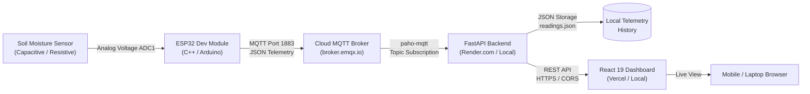

# 🌱 AgroPulse — Smart IoT Soil Moisture Monitoring System

A modern, full-stack Internet of Things (IoT) solution that continuously monitors soil moisture levels using an **ESP32**, streams telemetry via a public cloud **MQTT broker** (`broker.emqx.io`), converts and aggregates readings with a **FastAPI** backend, and renders an interactive, mobile-responsive dashboard in **React 19 + Vite**.

---

## 🏗️ Architecture



---

## ✨ Features

- **Real-Time Telemetry:** ESP32 samples and broadcasts moisture readings every 2 seconds.
- **Accurate Calibration:** Backend maps raw 12-bit ADC values (0–4095) into calibrated volumetric soil moisture percentages (0–100%).
- **Cloud MQTT Integration:** Operates across local networks and internet without local broker port forwarding (`broker.emqx.io:1883`).
- **Smart Irrigation Recommendations:** Automated watering advisories based on current moisture thresholds (Critically Dry, Low, Optimal, Saturated).
- **Interactive Modern UI:**
  - Dynamic circular SVG moisture gauge.
  - Multi-segment moisture zone spectrum indicator.
  - Recharts historical trend graph and telemetry log view.
  - Time synchronization across UTC and the user's local timezone.
- **Responsive Design:** Optimized for smartphones, tablets, and desktop displays with smooth touch interactions.
- **Zero-Cost Cloud Deployment:** Fully deployable on **Render** (FastAPI) and **Vercel** (React SPA).

---

## 📁 Repository Structure

```text
IOT_SOIL/
├── README.md                      # Project documentation
├── render.yaml                    # Infrastructure-as-code for Render deployment
├── run_all.sh                     # Automated local startup script
├── stop_all.sh                    # Automated process cleanup script
├── simulate_esp32.py              # Python telemetry simulator for testing
├── esp32/
│   ├── README.md                  # Hardware and firmware documentation
│   └── soil_monitor_esp32/
│       └── soil_monitor_esp32.ino # ESP32 Arduino firmware
├── mosquitto/
│   ├── README.md                  # Optional local Mosquitto reference
│   └── mosquitto.conf             # Local broker configuration file
├── soil-monitor-backend/
│   ├── README.md                  # Backend architecture and API documentation
│   ├── requirements.txt           # Python dependencies
│   ├── .env.example               # Template environment configuration
│   ├── test_backend.py            # Unit test suite
│   ├── data/
│   │   └── readings.json          # Persistent JSON telemetry store
│   └── app/
│       ├── main.py                # FastAPI entry point & CORS configuration
│       ├── mqtt/subscriber.py     # Background paho-mqtt subscriber
│       ├── routes/sensor.py       # REST API endpoints
│       ├── schemas/sensor.py      # Pydantic data models
│       └── services/              # Calibration, storage, and recommendations
└── soil-monitor-frontend/
    ├── README.md                  # Frontend development documentation
    ├── package.json               # Node.js dependencies
    ├── vercel.json                # Single-Page-App routing for Vercel
    ├── vite.config.js             # Vite configuration with /api proxy
    └── src/
        ├── App.jsx                # Main application component
        ├── App.css / index.css    # Tailwind CSS and theme design system
        ├── api/                   # Axios client with cache-busting
        ├── components/            # Dashboard cards and gauges
        ├── hooks/useSensorData.js # 3-second auto-polling hook
        └── pages/Dashboard.jsx    # Complete responsive dashboard view
```

---

## 🔌 Hardware Setup

### Wiring Diagram

| Soil Moisture Sensor | ESP32 Dev Module | Notes |
|:---|:---|:---|
| **VCC** | **3.3V** (or VIN) | 3.3V recommended to protect ADC |
| **GND** | **GND** | Common ground |
| **AOUT (Analog Out)** | **GPIO 34** | Must use ADC1 (ADC2 is disabled when Wi-Fi is active) |

### Calibration Reference

- **Air (Dry):** ADC Raw Value ≈ `3000` – `3500` (represents 0% moisture)
- **Water (Wet):** ADC Raw Value ≈ `1200` – `1600` (represents 100% moisture)
- Configurable via backend environment variables `DRY_RAW` and `WET_RAW`.

---

## 🚀 Quick Start (Local Development)

### 1. Automated Start (Recommended)

From the project root, launch both the backend and frontend simultaneously with automated environment setup and health checks:

```bash
cd /home/ansuman30/Music/IOT_SOIL
./run_local.sh
```

**Optional simulation:** To test without physical hardware, run:
```bash
./run_local.sh --simulate
```

- **Frontend Dashboard:** [http://localhost:5173](http://localhost:5173) (or phone on same Wi-Fi: `http://192.168.0.x:5173`)
- **Backend API Docs:** [http://localhost:8000/docs](http://localhost:8000/docs)
- **Health Check:** [http://localhost:8000/health](http://localhost:8000/health)

To stop all background services cleanly:
```bash
./stop_all.sh
```

---

### 2. Manual Setup

#### Backend Setup
```bash
cd soil-monitor-backend
python3 -m venv .venv
source .venv/bin/activate
pip install -r requirements.txt
uvicorn app.main:app --host 0.0.0.0 --port 8000 --reload
```

#### Frontend Setup
```bash
cd soil-monitor-frontend
npm install
npm run dev -- --host 0.0.0.0 --port 5173
```

---

## 📡 API Specification

| Method | Endpoint | Description |
|:---|:---|:---|
| `GET` | `/health` | Service health check (used by Render & Uptime monitors) |
| `GET` | `/api/sensor/latest` | Retrieves most recent reading (`moisture`, `raw_value`, `timestamp`) |
| `GET` | `/api/sensor/history` | Retrieves chronological moisture history for charting |
| `GET` | `/api/sensor/status` | Reports whether ESP32 has communicated within 15 seconds |
| `GET` | `/api/recommendations` | Smart watering dosage and priority advisory |
| `POST` | `/api/sensor/readings` | Ingests a new reading directly via HTTP (testing endpoint) |

Interactive Swagger documentation: `http://localhost:8000/docs`

---

## ☁️ Cloud Deployment (Render + Vercel)

The project is structured for easy deployment to free cloud tiers:

### 1. Backend on [Render](https://render.com)
1. Create a **New Web Service** connected to your GitHub repository.
2. Configure:
   - **Root Directory:** `soil-monitor-backend`
   - **Runtime:** `Python 3`
   - **Build Command:** `pip install -r requirements.txt`
   - **Start Command:** `uvicorn app.main:app --host 0.0.0.0 --port $PORT`
3. Add Environment Variables:
   - `MQTT_BROKER`: `broker.emqx.io`
   - `MQTT_PORT`: `1883`
   - `MQTT_USE_TLS`: `false`
   - `MQTT_TOPIC`: `soil-monitor/+/readings`
   - `CORS_ORIGINS`: `*`
   - `DRY_RAW`: `3000`
   - `WET_RAW`: `1200`
4. Copy your backend URL (e.g., `https://agropulse-backend.onrender.com`).

### 2. Frontend on [Vercel](https://vercel.com)
1. Create a **New Project** connected to your GitHub repository.
2. Configure:
   - **Root Directory:** `soil-monitor-frontend`
   - **Framework:** `Vite`
3. Add Environment Variable:
   - `VITE_API_URL`: `https://your-backend.onrender.com/api`
4. Click **Deploy**.

### 3. Keep Free Tier Active
To prevent Render free instances from sleeping after 15 minutes of inactivity, set up a free 5-minute HTTP monitor at [UptimeRobot](https://uptimerobot.com) pointing to:
`https://your-backend.onrender.com/health`

---

## 🧪 Testing Without Hardware

You can simulate sensor data with the included simulator script:

```bash
python3 simulate_esp32.py --device-id esp32-001 --interval 2
```

Or publish via MQTT directly:

```bash
python3 -c '
import paho.mqtt.publish as p, json
p.single("soil-monitor/esp32-001/readings", json.dumps({"device_id":"esp32-001","raw_value":1800,"timestamp":"2026-11-07T12:00:00Z"}), hostname="broker.emqx.io")
print("Published simulated reading")
'
```

---

## 📄 License

This project is licensed under the MIT License — open for academic, personal, and IoT prototype deployment.
